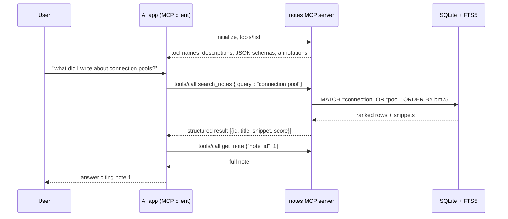

# MCP Knowledge Server

A **Model Context Protocol (MCP) server** that gives AI assistants (Claude Desktop, Claude Code, or any MCP client) a personal notes knowledge base: full-text search with BM25 ranking, read, create, update and delete notes, plus resources and prompt templates.
Built with the official MCP Python SDK (v2, `MCPServer`) and SQLite FTS5.

```text
$ python examples/demo_client.py
tools: search_notes, get_note, list_tags, add_note, update_note, delete_note
  [2] RAG chunking notes  score=0.926  **Chunk** by heading, ~800 chars with 150 overlap. Embed heading + text.

notes://recent ->
- [3] Hiking checklist (personal)
- [2] RAG chunking notes (ai, rag)
- [1] Postgres connection pooling (databases, work)

get_note(999) -> Error executing tool get_note: note 999 not found (is_error = True )
```

## What is MCP?

MCP is an open standard for connecting AI apps to tools and data. Instead of writing a custom integration for every app, you write **one server**, and any MCP client can use it. The server describes what it offers:

| MCP concept | Who decides to use it | This server |
|---|---|---|
| **Tools** (actions with JSON-schema inputs) | the model | `search_notes`, `get_note`, `list_tags`, `add_note`, `update_note`, `delete_note` |
| **Resources** (read-only data addressed by URI) | the app / user | `notes://recent`, `notes://{note_id}` |
| **Prompts** (reusable prompt templates) | the user | `summarize_tag`, `find_connections` |



## Features

- **Full-text search** with SQLite FTS5: Porter stemming, BM25 ranking (title matches weigh 5x, tags 2x), highlighted snippets, optional tag filter. The index is kept in sync by triggers.
- **Structured outputs**: tools return Pydantic models, so clients get a JSON schema for results, not just text.
- **Tool annotations** tell the client which tools are read-only and which are destructive (`delete_note`), so the app can ask the user before running them.
- **Least privilege**: `--read-only` mode does not even register the write tools.
- **Injection-safe**: all SQL is parameterised, and free-text search is converted into a quoted FTS5 query, so FTS operators (`NEAR`, `*`, column filters, unbalanced quotes) can't break or bend the search.
- **Input limits**: title/content length, max 10 tags, tag format validated. Errors use `ToolError` so the model gets a clear message ("note 999 not found") while unexpected crashes are hidden.
- **Prompt-injection hygiene**: server instructions and prompts say note content is data, not instructions.
- **Two transports**: stdio (local apps) and Streamable HTTP (bound to 127.0.0.1 by default).
- Logs go to **stderr**, because on stdio, stdout carries the protocol and a stray `print` would corrupt it.

## Quick start

```bash
git clone https://github.com/nitishfound/mcp-knowledge-server.git
cd mcp-knowledge-server
pip install -r requirements.txt
pytest -q
python examples/demo_client.py
```

### Use it from Claude Code

```bash
claude mcp add notes -- python -m notes_mcp --db ~/.mcp-notes/notes.db
```

### Use it from Claude Desktop

Add to `claude_desktop_config.json` (use the full path to the Python you installed the requirements into):

```json
{
  "mcpServers": {
    "notes": {
      "command": "python",
      "args": ["-m", "notes_mcp", "--db", "/home/you/.mcp-notes/notes.db"],
      "cwd": "/path/to/mcp-knowledge-server"
    }
  }
}
```

Add `"--read-only"` to the args to give the assistant search and read access only.

### HTTP mode

```bash
python -m notes_mcp --http --port 8000        # Streamable HTTP at http://127.0.0.1:8000/mcp
```

## Project structure

```
notes_mcp/
  store.py     SQLite + FTS5 store: add/get/update/delete/search/tags, safe FTS queries
  server.py    MCP server: tools, resources, prompts, read-only mode, CLI
examples/demo_client.py   launches the server over stdio and calls it
tests/        21 tests: store, injection attempts, MCP protocol in-process, real stdio subprocess
```

## Testing approach

- `test_store.py`: ranking, stemming, tag filter, update re-indexing, validation, and five injection strings (`'); DROP TABLE notes; --`, `NEAR(a b)`, unbalanced quotes...).
- `test_server.py`: talks real MCP to the server in-process (`mcp.Client(server)`): tool listing and annotations, read-only mode, structured outputs, error messages, resources, prompts.
- `test_stdio.py`: starts `python -m notes_mcp` as a subprocess and talks over stdin/stdout, exactly like Claude Desktop.

## License

MIT
